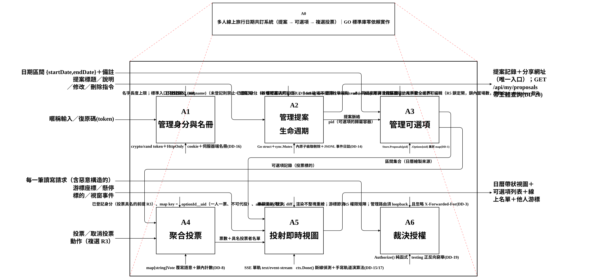
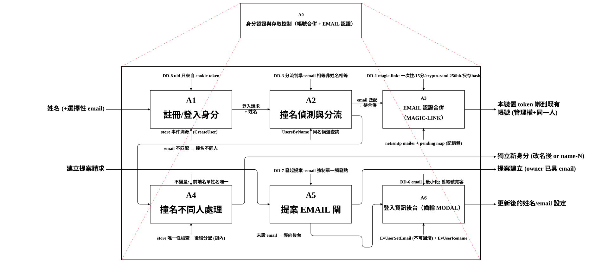
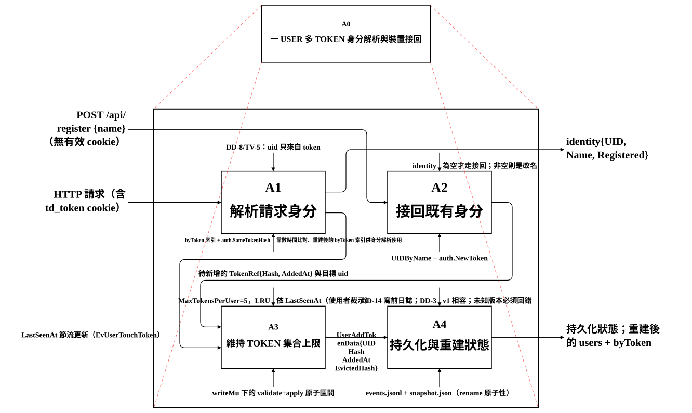
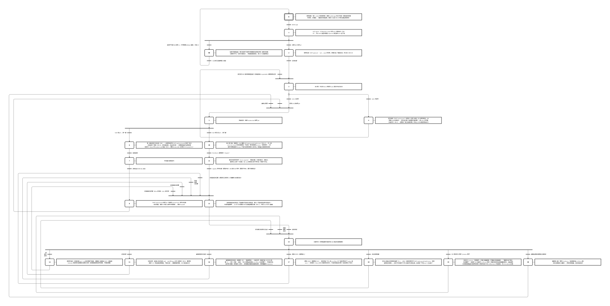
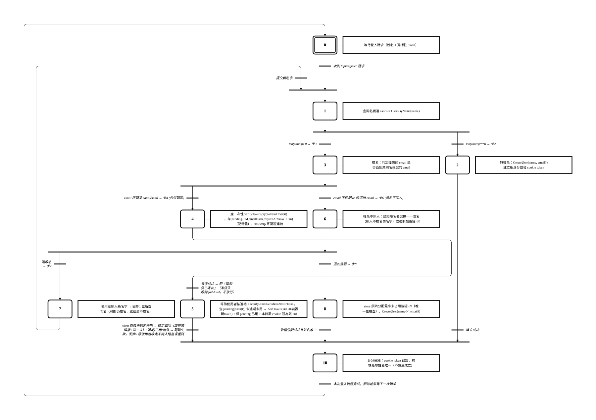
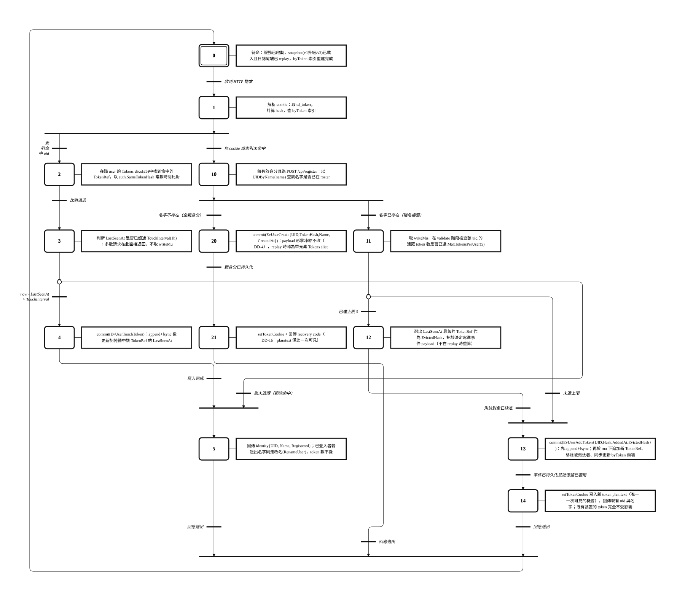

# teamdating — 多人線上旅行日期共訂系統

一套讓一群人**共同敲定旅行日期**的即時協作工具。發起人開一個提案、貼出候選的日期區間，參與者用複選投票表態「哪幾段我可以」，所有人即時看到彼此的選擇、線上狀態與游標——最後用票數最高的區間定案。

**技術主張：零第三方套件。** 後端是純 Go 標準庫，前端是零依賴的原生 ES module，整個系統編譯成**單一自帶前端資產的執行檔**，沒有 `node_modules`、沒有前端 build step、沒有外部服務相依。

---

## 特色

- **免帳號起步、跨裝置接回身分**：輸入名字即可參與；系統以 `crypto/rand` 產生的 token（HttpOnly cookie）綁定身分，並提供可讀的「復原碼」讓你在另一台裝置接回同一個身分。
- **複選日期投票**：每個候選區間你都能獨立表態，一人一票、不可代投——這由後端的決定性鍵結構（`optionId__uid`）本身保證，不需要交易。
- **即時協作**：單一 SSE 連線同時承載提案變更、投票變更、線上名單與他人游標；斷線由伺服器端第一手偵測（`ctx.Done()`），關分頁即正確清除游標，不需心跳或墓碑。
- **email 認證帳號合併**：撞名時若 email 匹配，寄出一次性 magic-link（15 分鐘、`crypto/rand` 256-bit、只存 hash）認證後合併身分；不匹配則改名或自動加後綴，確保名單姓名唯一。
- **伺服器端裁決為唯一安全邊界**：前端的隱藏與禁用只是便利，所有讀寫請求都經後端 `Authorize()` 純函式裁決。
- **事件溯源持久化**：狀態以 append + fsync 的事件日誌（JSONL）落地，先寫日誌再改記憶體；重啟時載入 snapshot 後 replay 日誌尾端重建，既有身分一把 token 都不遺失。

---

## 快速開始

需求：Go 1.24 以上。

```bash
# 建置（main package 在 ./cmd/teamdating）
go build -o teamdating ./cmd/teamdating

# 啟動（預設監聽本機；-base 設定掛載路徑前綴）
./teamdating -base /

# 瀏覽器開啟
open http://localhost:8080/
```

前端資產以 Go `embed` 打包進執行檔，部署時只需搬這一個 binary。

---

## 系統架構（IDEF0 功能分解）

系統以六個功能模組構成。下圖是 A0 系統全貌——每個模組的輸入、控制、輸出與機制（ICOM）一目了然：



| 模組 | 職責 |
|---|---|
| **A1 管理身分與名冊** | 把匿名訪客轉為具名參與者，讓身分跨 session、跨裝置可還原；名冊成為「誰還沒投」的分母 |
| **A2 管理提案生命週期** | 建立／檢視／修改／刪除一趟旅行的容器；提案是存取單位，刪除時級聯清除其下可選項與票 |
| **A3 管理可選項** | 在提案下新增候選日期區間；新增不等於表態，作者編輯權受「他人票數」閘控 |
| **A4 聚合投票** | 承接複選表態並維護計數；票的鍵為決定性組合鍵，一人一票由鍵結構本身保證 |
| **A5 投射即時視圖** | 合成日曆軌道、可選項列表、線上名單與他人游標；樂觀更新先行，伺服器回覆後校正 |
| **A6 裁決授權** | 對每個讀寫請求做伺服器端裁決——唯一真正的安全邊界 |

### A1 身分模組的兩個子系統

身分模組（A1）向下分解為兩個獨立子系統：

**email 認證與帳號合併**——撞名時依 email 是否匹配分流（合併認證 / 改名或加後綴）：



**多裝置 token 身分接回**——一個使用者可在多台裝置持有 token（上限 5，LRU 淘汰），跨裝置接回同一身分：



---

## 行為模型（GRAFCET 狀態機）

以 IEC 60848 GRAFCET 描述系統的 runtime 行為（步→轉換）。

### 主狀態機：從進入到即時協作

從 `/api/me` 身分解析、名冊載入、身分閘、路由裁決，到第一層提案列表與第二層 SSE 即時協作（新增／投票／編輯／游標／presence）：



其中一個設計重點：**後端不得靜默 fallback**——後端不可達時進入阻斷式錯誤畫面（顯示具體徵狀與修復步驟），而非假裝一切正常。

### email 認證狀態機

登入請求→查同名→撞名 email 分流→magic-link 寄信→按連結綁 token：



### 多裝置 token 狀態機

解析 cookie→常數時間比對→LastSeenAt 節流→碰名接回或全新身分→token 上限淘汰→事件持久化：



---

## 資料與持久化

狀態以**事件溯源**（event sourcing）落地：

- 所有變更先 append 到 `events.jsonl` 事件日誌並 `fsync`，再更新記憶體狀態——寫入順序不可顛倒。
- 啟動時載入 snapshot，再 replay 日誌尾端重建 `users` 與 `byToken` 索引。
- 舊版 snapshot（v1）會在載入時升級為 v2；未知版本一律回錯，不猜測。

沒有外部資料庫，沒有 ORM，沒有 migration 框架——只有標準庫的 `encoding/json` 與 `os`。

---

## 安全模型

- **伺服器端裁決是唯一安全邊界**：所有讀寫請求都經 `Authorize()` 純函式裁決；前端的隱藏與禁用只是便利，不構成保護。
- **uid 只來自 cookie token**，絕不從 request body 讀取。
- **token 比對用常數時間**（`crypto/subtle`），避免 timing side-channel。
- **管理路由僅限 loopback**，且忽略 `X-Forwarded-For`（不信任反向代理標頭）。
- **magic-link** 一次性、15 分鐘過期、`crypto/rand` 256-bit，只存 hash 不存明文。

---

## 專案結構

```
cmd/teamdating/      main package（進入點）
internal/
  httpapi/           HTTP handler、身分解析、授權裁決、SSE
  mailer/            net/smtp 寄信（magic-link）
  store/             事件溯源狀態機與持久化
web/                 零依賴 ES module 前端（embed 進 binary）
docs/diagrams/       IDEF0 / GRAFCET SVG
specs/               架構文件
```

環境變數（皆可選，未設則用安全預設）：

| 變數 | 用途 |
|---|---|
| `TEAMDATING_SMTP_HOST` | SMTP relay 位址（預設 `localhost:25`） |
| `TEAMDATING_SMTP_FROM` | 寄件人位址（預設 `noreply@localhost`） |

---

## 授權

本專案以零第三方套件為設計原則實作，僅依賴 Go 標準庫。
